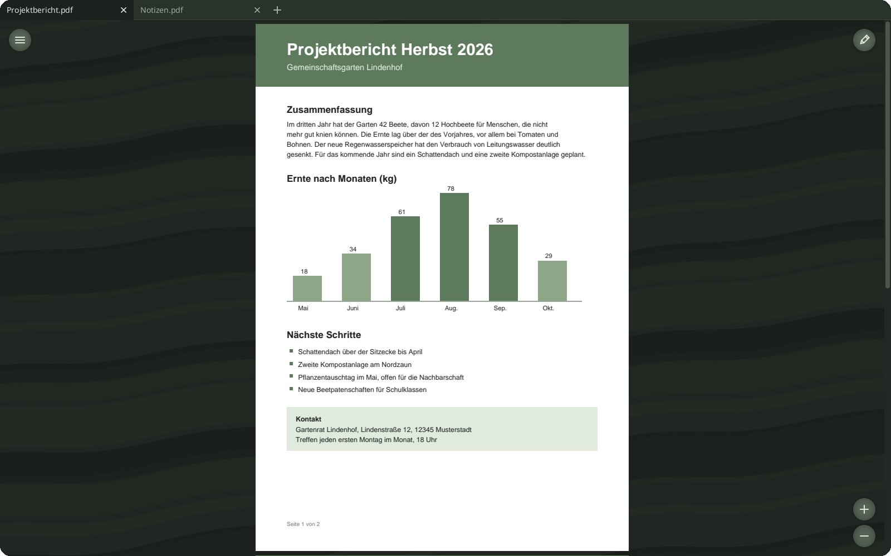
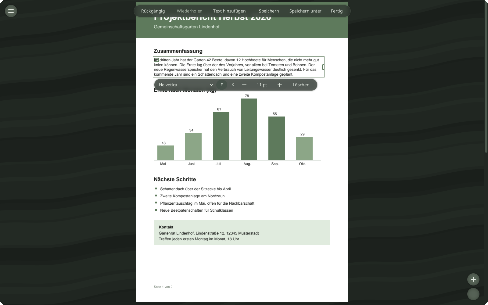
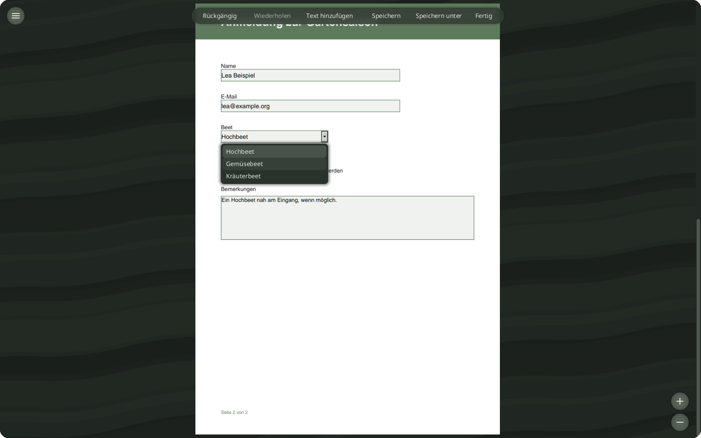
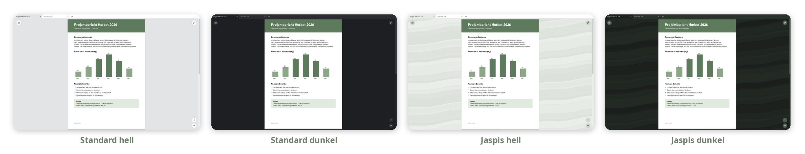

# JASPE PDF


**[Download the latest release](https://github.com/OxFaTech/JASPE-PDF-Release/releases/latest)**

PDF viewer and editor for Linux and Windows (x64) by OxFaTech. It shows PDF files in tabs, fills in
forms and edits existing text. Free of charge, closed source. The user interface is in German.

This repository contains only the finished packages (releases), no source code.



*Several PDF files as tabs, in the dark "Jaspis" (jasper) design.*



*Editor: a paragraph with a selected word, the width handle and the bar for font, style and size.*



*Filling in a form in the editor.*



*Standard and Jaspis, each light and dark.*

## Features

### Viewing
- Continuous scrolling through all pages, zoom from 10 to 800 % (buttons, shortcuts,
  Ctrl + mouse wheel at the pointer).
- Several PDF files as tabs. Open them via the file dialog, drag and drop or the command line; the
  recent files list can be turned off.
- Rotate the view in 90° steps. This only affects the view, the file stays unchanged.
- Internal links jump to their target page, web and mail links open the default application.
- Select text by dragging over it and copy it with Ctrl+C, to paste it into other programs.
- Light and dark follow the system.
- The window appears with the first page right away; everything else loads when needed.

### Editor
The editor starts with the pencil button at the top right (Ctrl+E) or with the start menu entry
"JASPE PDF Editor". It is not loaded on a normal start.

- Edit text: click a text object, click again or press Enter, type the new text. A line that
  consists of several parts in the PDF is selected and edited as a whole.
- Move text by dragging it with the mouse or with the arrow keys (1 pt, 10 pt with Shift); delete
  it with Del. While dragging, the text moves along, a grid shows and the text snaps to it, and rather to the middle of
  the page, to margins and columns, to edges of shapes and to the next line in the spacing used on
  the page; these guides are drawn thicker. Hold Alt to move freely.
- Font family, bold, italic and size from the bar below the selection. You can choose the standard
  families of every PDF application (Helvetica, Times, Courier, Symbol, ZapfDingbats) and installed
  TrueType fonts whose license allows embedding. An embedded system font adds its own size to the
  file.
- New text: "Text hinzufügen" (add text), click on the page, type, Enter. Shift+Enter or Alt+Enter
  starts a new line; text with several lines becomes a paragraph.
- Typing: Enter, Tab or a click elsewhere takes the text, Esc discards it. Where several lines are
  possible (paragraphs, multi-line form fields, entries), Shift+Enter or Alt+Enter breaks the line.
- Multiple selection: Ctrl+click or Shift+click, or drag a rectangle on an empty area. Moving,
  deleting, size and style apply to all selected objects.
- Paragraph: selected text can be combined into a paragraph from the bar ("Absatz"). Drag its right
  edge to set the width; the text wraps as you type, and single words can be bold, italic or in
  another font.
- Copy, cut and paste (Ctrl+C, Ctrl+X, Ctrl+V): pasted text goes to the mouse pointer. Within a
  document it keeps its font, size and color; in another document it gets the same family if
  installed, otherwise a similar standard font.
- Fill in forms: text fields (also multi-line), check boxes, radio buttons, combo boxes and list
  boxes. Read-only fields, buttons and signature fields stay unchanged.
- Add form fields: "Feld hinzufügen" (add field), choose the kind (text, multi-line text, check box,
  radio button, combo box, list box) and draw a rectangle on the page. A handle at a field's corner
  selects it: name, required, read-only, multi-line, entries, another radio button for the group,
  delete. Works with fields already in the PDF too, and can be undone.
- Pages: a bar under each page moves it up or down and adds an empty page after it; its menu adds
  an empty page in another format (A3 to A6, US Letter, portrait or landscape), inserts the pages
  of other PDFs, turns or deletes the page. "Seiten" (pages) opens a window with all pages as
  thumbnails: pick them with a click (Ctrl, Shift for more), drag them to a new place, add, import,
  turn or delete them.
- Undo and redo.
- Saving appends the changes to the file; the original bytes are kept. Before overwriting a file
  for the first time, JASPE PDF asks (cancel, save as, overwrite). Closing with unsaved changes
  asks as well.

Outside paragraphs, changes apply per text object (usually a word or a line). If the font of a text
lacks characters, JASPE PDF uses a similar standard font. If that one does not cover them either, a
notice appears and another font has to be chosen.

### Security
- The PDF library PDFium runs in a separate, sandboxed process. If it crashes on a file, only that
  tab shows a message.
  - Linux: Landlock (reading only font folders) and seccomp (no network, no starting programs).
    If the system does not allow the sandbox in full (old kernel, some containers), JASPE PDF says
    so once per session.
  - Windows: an AppContainer (no network, no access to the user's files; it reads only the
    program folder and the user's fonts) in a job object (no further processes, limited memory,
    no clipboard or desktop access, ends with JASPE PDF), plus process mitigations such as no
    code generated at run time. If Windows refuses the AppContainer, JASPE PDF says so.
- Scripts in PDF files are never run: the PDFium build used has no JavaScript engine and no XFA.
- PDF actions have no effect except links: forms are not submitted, no data is imported, no
  program is started, and links to other files or into attachments are ignored.
- Attachments (embedded files, such as the XML of a ZUGFeRD or Factur-X invoice) are never read,
  opened or extracted. Saving keeps them unchanged.
- Only `http`, `https` and `mailto` links are opened; `file:`, `javascript:` and other schemes never
  are, nor addresses with control characters or invisible direction and zero-width characters.
  Before opening a link, JASPE PDF asks and shows where it leads (host or recipient) and the full
  address (can be turned off). Attachments in mail links can be removed.
- If JASPE PDF itself crashes, it writes the version, the time and the error with its place in the
  source code to `crash.log` in its settings folder, nothing else, and says where on the next
  start. Nothing is sent.
- On first start, a notice points out that PDF files can contain harmful content and that JASPE PDF
  does not check them yet.

### What this means for some PDFs
- Forms with scripts: calculated fields (sums, tax) do not update, formatting (dates, amounts) and
  checks while typing are missing, fields a script would show or hide stay as they are in the
  file. Entered values are still saved.
- Pure XFA forms (some government and LiveCycle forms) show only their fallback page, usually a
  note to use another reader.
- Links to other files and PDF portfolios do nothing; a portfolio shows its cover page only.
- Attachments are not shown and cannot be saved.
- Digital signatures are not checked for authenticity. JASPE PDF recognises signed files and only
  changes what the signature allows: if it allows no changes, the file can only be read; otherwise
  form fields the signature does not lock can be filled in, and saving appends only their values,
  so the signature stays valid.
- E-invoices (ZUGFeRD, Factur-X): changes to the visible content do not change the embedded XML,
  which is what counts legally, and the file is no longer valid PDF/A-3 afterwards.

### Settings and design
Hamburger menu at the top left, then "Einstellungen" (settings).

- On start: window or maximized.
- Design: Standard or "Jaspis" (banded jasper behind the pages with slow waves running through it, buttons and bars
  of tinted glass), each light or dark following the system. Jaspis needs a little more computing
  time; the movement can be turned off.
- Thin or normal scroll bars, scroll speed.
- Grid for moving text: on or off, spacing in millimetres.
- All shortcuts can be changed.

## Installation

### Windows

Download `JASPE_PDF-<version>-x64-setup.exe` from the
[releases](https://github.com/OxFaTech/JASPE-PDF-Release/releases/latest) (Windows 10 and 11, x64).
The installer asks whether to install for the current user only (no administrator rights needed) or
for all users, and creates the start menu entries "JASPE PDF" and "JASPE PDF Editor". JASPE PDF
appears under "Open with" and in the default apps settings; only you choose the default app.

The installer is not signed, so Windows SmartScreen warns on first start: "More info", then
"Run anyway".

Via winget, once the package has been accepted: `winget install OxFaTech.JASPEPDF`. Update with
`winget upgrade`.

Portable: unpack `JASPE_PDF-<version>-x64-portable.zip` and start `jaspe.exe` in the folder
"JASPE PDF". While `portable.txt` is next to it, settings, recent files and crash reports stay in
the subfolder `Daten` instead of the user profile; there are no start menu entries and no file
association. To remove it, delete the folder.

### Arch Linux / CachyOS: pacman repository

Add once to `/etc/pacman.conf`:

```ini
[jaspe]
SigLevel = Optional TrustAll
Server = https://github.com/OxFaTech/JASPE-PDF-Release/releases/latest/download
```

Then install:

```sh
sudo pacman -Sy jaspe
```

Updates come with `sudo pacman -Syu`. The packages are not signed yet; they are downloaded over
HTTPS from GitHub.

### Other Linux distributions

From the [releases](https://github.com/OxFaTech/JASPE-PDF-Release/releases/latest):

- `JASPE_PDF-<version>-x86_64.AppImage`
- `jaspe_<version>_amd64.deb`, installed with `sudo apt install ./jaspe_<version>_amd64.deb`
- `jaspe-<version>-x86_64.tar.gz` as a plain archive

Requirements: glibc 2.34 or newer (for example Ubuntu 22.04, Debian 12, Fedora, RHEL, AlmaLinux and
Rocky Linux 9 and newer). Only `libc`, `libm` and `libgcc_s` are linked directly; Wayland or X11 and
`libxkbcommon` are loaded at runtime. JASPE PDF runs on Wayland and X11.

The file dialog, color scheme and opening links go through the XDG desktop portal (present on KDE,
GNOME and most desktops). Without it, for example on plain window managers, JASPE PDF uses `zenity`
or `kdialog` as the file dialog and `xdg-open` for links; without those, a notice appears.

## Shortcuts

Default keys, changeable in the program.

| Action | Keys |
|---|---|
| Open | Ctrl+O |
| New tab | Ctrl+T |
| Close | Ctrl+W |
| Next / previous tab | Ctrl+Tab / Ctrl+Shift+Tab |
| Zoom in / out | Ctrl++ / Ctrl+- |
| Rotate view right / left | Ctrl+R / Ctrl+Shift+R |
| Edit | Ctrl+E |
| Undo / redo | Ctrl+Z / Ctrl+Shift+Z |
| Copy / cut / paste | Ctrl+C / Ctrl+X / Ctrl+V |
| Save / save as | Ctrl+S / Ctrl+Shift+S |
| Delete selection / edit text / move | Del / Enter / arrow keys |
| Add an object to the selection | Ctrl+click or Shift+click |
| Next / previous page | Page Down / Page Up |
| Go to start / end | Home / End |
| One screen forward / back | Space / Shift+Space |

Esc closes the menu and the settings and cancels input.

## The name

JASPE stands for "Just A Smart PDF Editor" and for Jaspe, the jasper stone. Seals were once cut from
this stone. Their imprint on a document showed that it was finished and genuine. A PDF often feels
the same: set in stone and sealed. With JASPE PDF you can still view, fill in and change it.

## License

Use is free of charge, all rights reserved. Obtain it only from OxFaTech's sources; no
modification, no sale, no redistribution. The file [`LICENSE`](LICENSE) (English) is binding,
[`LICENSE.de`](LICENSE.de) is a German translation. Both are in this repository and come with every
release.

JASPE PDF includes PDFium and other third-party components. Their licenses come with every package.

## Support and contact

- Website: [oxfatech.de](https://oxfatech.de)
- Support: [support@oxfatech.de](mailto:support@oxfatech.de)

© 2026 Lucas Damme, OxFaTech Computer Services
