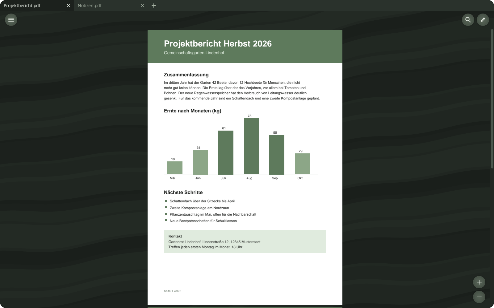
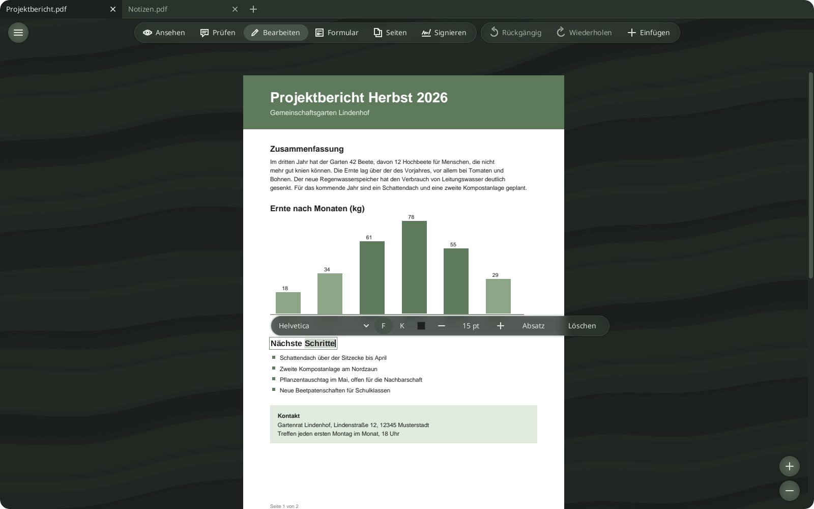
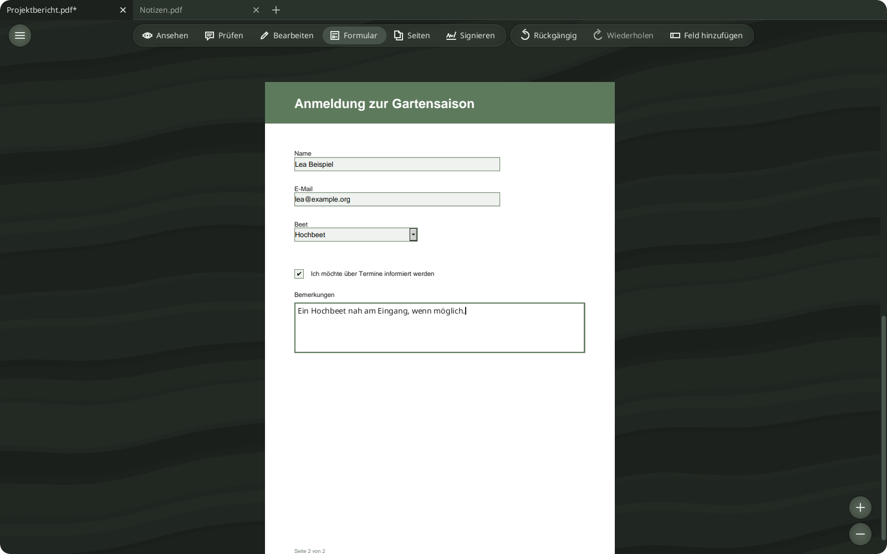
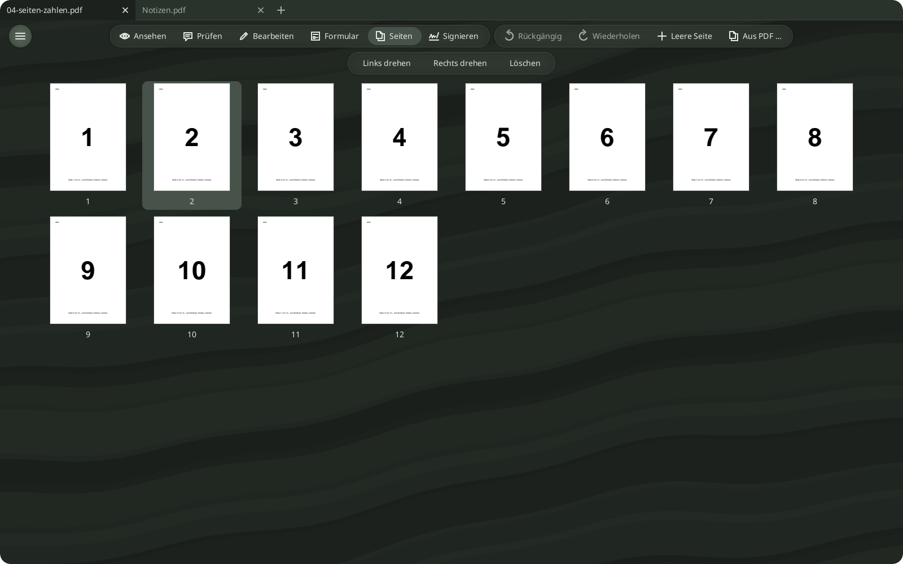
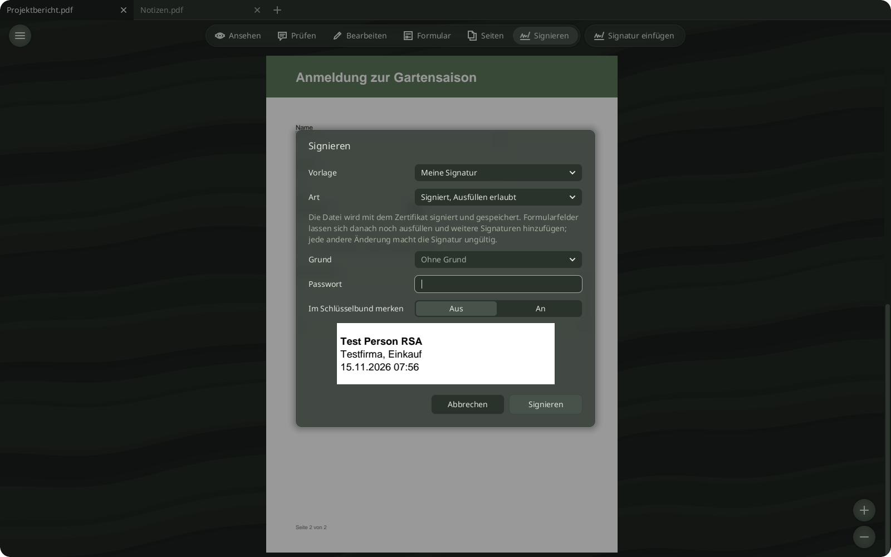
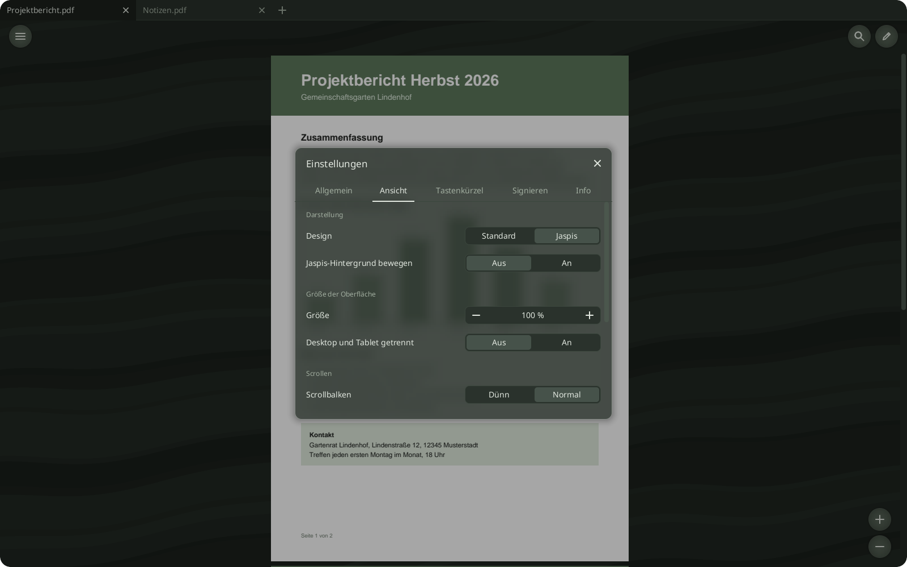
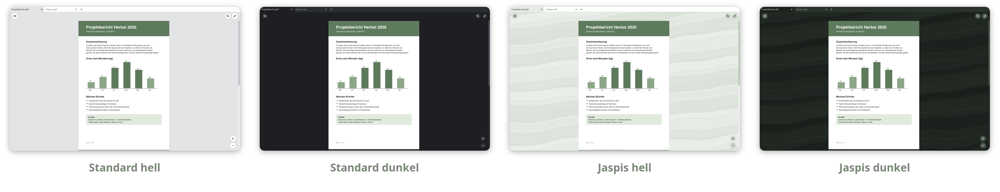

# JASPE PDF


**[Download the latest release](https://github.com/OxFaTech/JASPE-PDF-Release/releases/latest)**

PDF viewer and editor for Linux and Windows (x64) by OxFaTech: view PDF files, edit them, fill in
and build forms, arrange pages, sign. Free of charge, closed source. The user interface is in
German.

This repository contains only the finished packages (releases), no source code.



*Viewing: two PDF files as tabs in the dark "Jaspis" (jasper) design; search and the pencil are at
the top right.*



*Task "Bearbeiten" (edit): the bar of tasks, a selected word and the bar for font, bold, italic,
color and size.*



*Task "Formular" (form): a filled-in form.*



*Task "Seiten" (pages): all pages as a grid, one page selected.*



*Task "Signieren" (sign): template, kind of signature, reason and password, with a preview.*



*Settings, page "Ansicht" (view).*



*Standard and Jaspis, each light and dark.*

## Features

### Viewing
- Continuous scrolling through all pages, zoom from 10 to 800 % (buttons, shortcuts,
  Ctrl + mouse wheel at the pointer).
- Several PDF files as tabs. Open them via the file dialog, drag and drop or the command line.
  A second start hands its files to the window that is already open. The recent files list can
  be turned off.
- Search: the magnifier at the top right or Ctrl+F. Upper and lower case do not matter. Hits are
  marked on the pages; Enter or F3 shows the next one, Shift+Enter the previous one, Esc closes
  the search.
- Rotate the view in 90° steps. This only affects the view, the file stays unchanged.
- Internal links jump to their target page, web and mail links open the default application.
  After a jump (link, search hit, double click in the page grid), Alt+← or the back button of the
  mouse returns to the place before, Alt+→ or the forward button goes forward again.
- Select text by dragging over it (double click: a word, triple click: a line, Shift+click
  extends) and copy it with Ctrl+C, to paste it into other programs.
- Form fields can be filled in right here, without opening the tasks; Ctrl+Z and Ctrl+S undo and
  save.
- Pointing at a note or a commented highlight shows its text.
- Light and dark follow the system.
- The window appears with the first page right away; everything else loads when needed.

### Tasks
Viewing shows only the menu (top left), the magnifier and the pencil (top right). The pencil or
Ctrl+E shows the bar of tasks: "Ansehen" (view, hides the bar again), "Prüfen" (review),
"Bearbeiten" (edit), "Formular" (form), "Seiten" (pages) and "Signieren" (sign), with the tools of
the chosen task next to it or below it. The pencil opens the task the document used last, the
first time "Bearbeiten"; every tab keeps its own task. Ctrl+1 to Ctrl+5 choose the tasks directly.
"Ansehen", Ctrl+E, or Esc when nothing is open or selected, lead back to viewing. In a narrow
window buttons show only their icon; the word then appears as a tooltip.

The start menu entry "JASPE PDF Editor" opens files in "Bearbeiten".

All tasks except "Signieren" have undo and redo (Ctrl+Z, Ctrl+Shift+Z).

#### Prüfen (review)
- "Kommentar" (comment): select text, choose "Kommentar" and type; the text is highlighted and
  carries the comment. Without selected text, click on the page to place a note.
- "Markierung" (highlight): select text and choose it, or choose it and drag over text.
- Notes and highlights, also from other programs, can be selected and deleted, notes moved, and
  their comment changed.
- Text of the pages can be selected and copied as in viewing.

#### Bearbeiten (edit)
- Edit text: a click on text puts the cursor there, and you type in place. A line that consists
  of several parts in the PDF is edited as a whole. Enter, Tab or a click elsewhere takes the
  text, Esc discards it. Where several lines are possible, Shift+Enter or Alt+Enter breaks the
  line.
- The bar at the text: font family, bold, italic, color, size, "Absatz" (paragraph), delete.
  Selected characters (drag, double click, Shift+arrow keys) can get their own font, style, size
  and color.
- Fonts: the standard families of every PDF application (Helvetica, Times, Courier, Symbol,
  ZapfDingbats) and installed TrueType fonts whose license allows embedding. An embedded system
  font adds its own size to the file.
- Move text, images and drawings by dragging them with the mouse or with the arrow keys (1 pt,
  10 pt with Shift); delete them with Del. They can be dragged onto another page; nothing can be
  pushed entirely off its page. A link over them moves along and goes when they are deleted.
  While dragging, a grid shows and the selection snaps to it, and
  rather to the middle of the page, to margins and columns, to edges of shapes and to the next
  line in the spacing used on the page. Hold Alt to move freely.
- Multiple selection: Ctrl+click or Shift+click, or drag a rectangle on an empty area. Moving,
  deleting, size and style apply to all selected objects.
- Images and drawings on the page can be resized by their corners and moved one layer forward or
  backward or all the way to the front or back.
- "Einfügen" (insert): text, images (PNG, JPEG, WebP, GIF) and shapes (rectangle, ellipse, line,
  arrow). A bar sets line color, fill and line width of drawings.
- Paragraph: "Absatz" combines the selected text into a paragraph. Drag its right edge to set the
  width; the text wraps as you type.
- Copy, cut and paste (Ctrl+C, Ctrl+X, Ctrl+V): pasted objects go to the mouse pointer. Within a
  document text keeps its font, size and color; in another document it gets the same family if
  installed, otherwise a similar standard font. While typing, these keys work with the system
  clipboard (plain text).
- Form fields can be filled in here as well.

Outside paragraphs, changes apply per text object (usually a word or a line). If the font of a text
lacks characters, JASPE PDF uses a similar standard font. If that one does not cover them either, a
notice appears and another font has to be chosen.

#### Formular (form)
- Fill in forms: text fields (also multi-line), check boxes, radio buttons, combo boxes and list
  boxes. Tab moves to the next text field, Shift+Tab to the previous one. Read-only fields,
  buttons and signature fields stay unchanged.
- "Feld hinzufügen" (add field): choose the kind (text, multi-line text, check box, radio button,
  combo box, list box) and draw a rectangle on the page or click.
- A handle at a field's corner selects it. The field can then be moved and resized, and its bar
  sets name, required, read-only, multi-line, entries, another radio button for the group, and
  deletes it. This works with fields already in the PDF too.

#### Seiten (pages)
- The task shows all pages as a grid instead of the document.
- A click selects a page, Ctrl+click adds or removes one, Shift+click selects a range, Ctrl+A all.
  Dragging moves the selected pages; a double click shows the page in viewing.
- "Leere Seite" (empty page) adds a page in the format of its neighbour, A3 to A6 or US Letter,
  portrait or landscape. "Aus PDF …" (from PDF) inserts all pages of one or more other files.
  Both go after the last selected page, otherwise to the end.
- The bar of the selected pages turns them left or right or deletes them (also Del).

#### Signieren (sign)
- "Signatur einfügen" (insert signature): draw a rectangle on the page or click, then pick a
  template and how to sign:
  - only visible: an image of the signature with name, department, place and date, no
    certificate; it can be moved and resized like an image;
  - signed, with filling in still allowed;
  - signed and locked.
- Templates and certificates are set up under Settings → "Signieren". A certificate is made on
  your computer (RSA 3072, self-signed, five years) or imported from a `.p12`/`.pfx` file (RSA or
  elliptic curves P-256 and P-384); it can be exported as a `.p12`/`.pfx` file with a new
  password. A photo or scan of a handwritten signature loses its paper background.
- The private key is stored only encrypted with your password. JASPE PDF does not store the
  password itself. If you choose to have it remembered, it goes to the password store of the
  system (GNOME Keyring or KWallet on Linux, Windows Credential Manager on Windows).
  - Windows Hello: where it is set up, the remembered password is stored encrypted and released
    only after Windows Hello has confirmed you (face, finger or PIN).
  - Security key (Windows): the remembered password can instead be tied to a FIDO2 security key;
    signing then asks for the key.
  - Fingerprint (Linux): with a fingerprint reader set up in the system (fprintd), JASPE PDF asks
    for the finger before it fetches the remembered password. This is a check only; the password
    is protected by the keyring.
- The signature is a standard PAdES signature (`ETSI.CAdES.detached`), optionally with an RFC 3161
  timestamp from a time server such as DigiCert.
- A file that is already signed can get further signatures with a certificate; "only visible" is
  not offered there because it would make the existing signatures invalid.
- "Signatur entfernen" (remove signature): if the last signature of a file was made with your own
  certificate, JASPE PDF can remove it again after asking for its password. The file is then as
  it was before signing and is saved under a name you choose.

### Saving
- "Speichern" (save, Ctrl+S) is in the menu; "Speichern unter" (save as, Ctrl+Shift+S) appears
  there once the tasks are open.
- Saving appends the changes to the file; the original bytes are kept. Before overwriting a file
  for the first time, JASPE PDF asks (cancel, save as, overwrite).
- Unsaved changes show as "*" after the name in the tab and in the window title. Closing with
  unsaved changes asks (discard, save, save as). If several documents have changes when the
  window is closed, JASPE PDF asks once for all of them or, if you prefer, for each document.

### Touch and pen
- A tap works like a click. Swiping scrolls what is under the finger; two fingers zoom and scroll.
- Holding a finger for half a second selects text in viewing and drags in the tasks, like the
  pressed mouse button. Selected objects, handles and sliders drag at once.
- A long press on a button that shows only its icon shows its word; on a link it shows where the
  link leads.
- While typing, the text input of the system is switched on (input methods, on-screen keyboard).
- A pen works like the left mouse button.

### Security
- The PDF library PDFium runs in a separate, sandboxed process. If it crashes on a file, only that
  tab shows a message.
  - Linux: Landlock (reading only font folders) and seccomp (no network, no starting programs).
    If the system does not allow the sandbox in full (old kernel, some containers), JASPE PDF says
    so once per session. Without Landlock the process can read the files JASPE PDF can read, but
    cannot change or delete any.
  - Windows: an AppContainer (no network, no access to the user's files; it reads only the
    program folder and the user's fonts) in a job object (no further processes, limited memory,
    no clipboard or desktop access, ends with JASPE PDF), plus process mitigations such as no
    code generated at run time. If Windows refuses the AppContainer, JASPE PDF says so; the
    process then cannot write, but it can read the files JASPE PDF can read and reach the
    network.
- Scripts in PDF files are never run: the PDFium build used has no JavaScript engine and no XFA.
- PDF actions have no effect except links: forms are not submitted, no data is imported, no
  program is started, and links to other files or into attachments are ignored.
- Attachments (embedded files) are never opened or extracted. Only the XML of an e-invoice is read,
  as plain data. Saving keeps attachments unchanged.
- Network: JASPE PDF goes online only to fetch a timestamp when signing, if the signature template
  names a time server and "Netzwerkzugriffe zulassen" (allow network access, Settings →
  "Allgemein") is on; it is off by default. The PDF library has no network access while its
  sandbox is in effect (see the exceptions above).
- Private keys for signing never leave the main process and are stored only encrypted (PBES2 with
  scrypt and AES-256). JASPE PDF does not store passwords itself; a remembered password is kept
  by the password store of the system (see "Signieren").
- Only `http`, `https` and `mailto` links are opened; `file:`, `javascript:` and other schemes never
  are, nor addresses with control characters or invisible direction and zero-width characters.
  Before opening a link, JASPE PDF asks and shows where it leads (host or recipient) and the full
  address (can be turned off). Attachments in mail links can be removed.
- If JASPE PDF itself crashes, it writes the version, the operating system and architecture, the
  time, the thread and the error with its place in the source code to `crash.log` in its settings
  folder, nothing else, and says where on the next start. Nothing is sent.
- On first start, a notice points out that PDF files can contain harmful content and that JASPE PDF
  does not check them yet.

### What this means for some PDFs
- Password-protected PDF files cannot be opened yet.
- In encrypted PDF files (without a password for opening), form fields cannot be added or changed.
- Form fields on pages inserted from another PDF stay visible but cannot be filled in.
- Forms with scripts: calculated fields (sums, tax) do not update, formatting (dates, amounts) and
  checks while typing are missing, fields a script would show or hide stay as they are in the
  file. Entered values are still saved.
- Pure XFA forms (some government and LiveCycle forms) show only their fallback page, usually a
  note to use another reader.
- Links to other files and PDF portfolios do nothing; a portfolio shows its cover page only.
- Attachments are not shown and cannot be saved, except that the XML of an e-invoice is read
  (see below).
- Digital signatures are not checked for authenticity. JASPE PDF recognises signed files and only
  changes what the signature allows: if it allows no changes, the file can only be read; otherwise
  form fields the signature does not lock can be filled in, and saving appends only their values,
  so the signature stays valid.
- E-invoices (ZUGFeRD, Factur-X): changes to the visible content do not change the embedded XML,
  which is what counts legally, and the file is no longer valid PDF/A-3 afterwards.

E-invoices: if a PDF carries an e-invoice (ZUGFeRD, Factur-X, XRechnung in CII or UBL), "E-Rechnung"
shows at the top right. A click opens the invoice data at the right side: number, dates, seller,
buyer, bank account, positions, taxes and totals, or all values of the file. A click on a value
copies it. The XML is read as plain data in the sandboxed render process, without DTDs or external
references. A setting opens the panel whenever such a file is opened.

### Settings and design
Hamburger menu at the top left, then "Einstellungen" (settings); the shortcut is Ctrl+comma. The
pages:

- "Allgemein" (general): start as window or maximized; ask once or per document when closing with
  changes; recent files on or off and how many; show the target of a link when pointing at it;
  ask before opening links; remove attachments from mail links; show invoice data on opening;
  allow network access (only for timestamps when signing, off by default).
- "Ansicht" (view): design Standard or "Jaspis" (banded jasper behind the pages with slow waves
  running through it, buttons and bars of tinted glass), each light or dark following the system;
  Jaspis needs a little more computing time, and the movement can be turned off. Size of the
  interface from 70 to 200 %, separately for desktop and tablet use if wanted. Thin or normal
  scroll bars, scroll speed. Floating buttons for rotating the view. Grid for moving: on or off,
  spacing in millimetres. Show the image itself while resizing.
- "Tastenkürzel" (shortcuts): all shortcuts can be changed.
- "Signieren" (signing): templates, certificates and remembered reasons.
- "Info": version, PDFium build, vendor, website, support, license.

## Installation

### Windows

Download `JASPE_PDF-<version>-x64-setup.exe` from the
[releases](https://github.com/OxFaTech/JASPE-PDF-Release/releases/latest) (Windows 10 and 11, x64).
The installer asks whether to install for the current user only (no administrator rights needed,
into `%LOCALAPPDATA%\Programs\JASPE PDF`) or for all users (`C:\Program Files\JASPE PDF`). It
creates the start menu entries "JASPE PDF" and "JASPE PDF Editor" and, if you want, a desktop
icon. JASPE PDF appears under "Open with" and in the default apps settings, and the context menu
of PDF files offers "Bearbeiten" (edit); only you choose the default app. Uninstall it in the
Windows settings; your settings in `%APPDATA%\OxFaTech\JASPE` are kept.

The installer is not signed, so Windows SmartScreen warns on first start: "More info", then
"Run anyway".

winget: the package `OxFaTech.JASPEPDF` has been submitted but is not accepted yet. Until it is
listed, use the installer from the releases.

Portable: unpack `JASPE_PDF-<version>-x64-portable.zip` and start `jaspe.exe` in the folder
"JASPE PDF". While `portable.txt` is next to it, settings, recent files and crash reports stay in
the subfolder `Daten` instead of the user profile; there are no start menu entries and no file
association. To remove it, delete the folder.

### Arch Linux / CachyOS: pacman repository

Add once to `/etc/pacman.conf`:

```ini
[jaspe]
SigLevel = Optional TrustAll
Server = https://github.com/OxFaTech/JASPE-PDF-Release/releases/latest/download
```

Then install:

```sh
sudo pacman -Sy jaspe
```

Updates come with `sudo pacman -Syu`. The packages are not signed yet; they are downloaded over
HTTPS from GitHub.

A package in the AUR is planned.

### Other Linux distributions

From the [releases](https://github.com/OxFaTech/JASPE-PDF-Release/releases/latest):

- `JASPE_PDF-<version>-x86_64.AppImage`
- `jaspe_<version>_amd64.deb`, installed with `sudo apt install ./jaspe_<version>_amd64.deb`
- `jaspe-<version>-x86_64.tar.gz` as a plain archive

Requirements: glibc 2.35 or newer (for example Ubuntu 22.04, Debian 12 and newer, current Fedora).
Older systems are not supported. Only `libc`, `libm` and `libgcc_s` are linked directly; Wayland or
X11 and `libxkbcommon` are loaded at runtime. JASPE PDF runs on Wayland and X11.

The file dialog, color scheme and opening links go through the XDG desktop portal (present on KDE,
GNOME and most desktops). Without it, for example on plain window managers, JASPE PDF uses `zenity`
or `kdialog` as the file dialog and `xdg-open` for links; without those, a notice appears.

## Shortcuts

Default keys, changeable in the program.

| Action | Keys |
|---|---|
| Open | Ctrl+O |
| New tab | Ctrl+T |
| Close | Ctrl+W |
| Open / close the menu | F10 |
| Open / close the settings | Ctrl+, |
| Next / previous tab | Ctrl+Tab / Ctrl+Shift+Tab |
| Zoom in / out | Ctrl++ / Ctrl+- |
| Rotate view right / left | Ctrl+R / Ctrl+Shift+R |
| Find | Ctrl+F |
| Next / previous hit | Enter or F3 / Shift+Enter |
| Tasks on / off (like the pencil) | Ctrl+E |
| Task Prüfen / Bearbeiten / Formular / Seiten / Signieren | Ctrl+1 / Ctrl+2 / Ctrl+3 / Ctrl+4 / Ctrl+5 |
| Undo / redo | Ctrl+Z / Ctrl+Shift+Z |
| Copy / cut / paste | Ctrl+C / Ctrl+X / Ctrl+V |
| Save / save as | Ctrl+S / Ctrl+Shift+S |
| Delete selection / move it | Del / arrow keys (10 pt with Shift) |
| Add an object to the selection | Ctrl+click or Shift+click |
| Object one layer forward / backward | Ctrl+↑ / Ctrl+↓ |
| Object to the front / to the back | Ctrl+Shift+↑ / Ctrl+Shift+↓ |
| Next / previous text field of a form | Tab / Shift+Tab |
| Select all pages (page grid) | Ctrl+A |
| Next / previous page | Page Down / Page Up |
| Go to start / end | Home / End |
| Back to the place before / forward again | Alt+← / Alt+→ (mouse: back / forward button) |
| Scroll | arrow keys |
| One screen forward / back | Space / Shift+Space |

Esc closes the menu, the search and the settings, cancels input and, when nothing is open or
selected, leads back to viewing. Esc cannot be reassigned.

## The name

JASPE stands for "Just A Smart PDF Editor" and for Jaspe, the jasper stone. Seals were once cut from
this stone. Their imprint on a document showed that it was finished and genuine. A PDF often feels
the same: set in stone and sealed. With JASPE PDF you can still view, fill in and change it.

## License

Use is free of charge, all rights reserved. Obtain it only from OxFaTech's sources; no
modification, no sale, no redistribution. The file [`LICENSE`](LICENSE) (English) is binding,
[`LICENSE.de`](LICENSE.de) is a German translation. Both are in this repository and come with every
release.

JASPE PDF includes PDFium and other third-party components. Their licenses come with every package.

## Support and contact

- Website: [oxfatech.de](https://oxfatech.de)
- Support: [support@oxfatech.de](mailto:support@oxfatech.de)

© 2026 Lucas Damme, OxFaTech Computer Services
